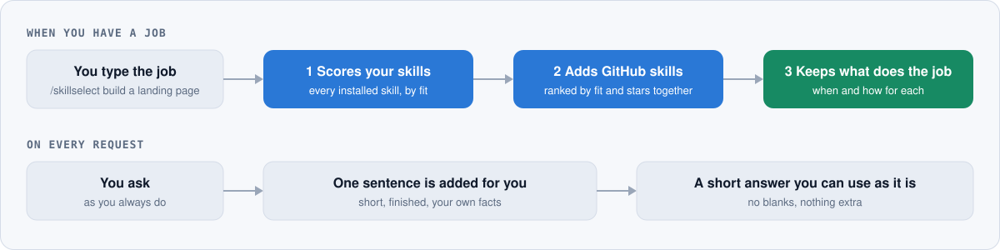
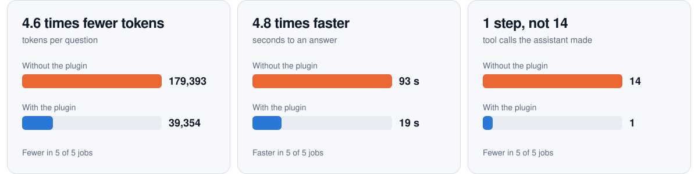

<p align="center">
  <picture>
    <source media="(prefers-color-scheme: dark)" srcset="assets/hero-dark.svg">
    
  </picture>
</p>

<p align="center">
  
</p>

<p align="center"><sub>The Claude Code window is redrawn from a saved session, with links cut to fit and the wait for the search sped up. The request shown took 27 seconds and one step. Across five jobs the plugin used 4.6 times fewer tokens (39,354 against 179,393) and answered 4.8 times faster (19 seconds against 93), in 1 step instead of 14. <a href="assets/demo.mp4">Download the clip</a>.</sub></p>

<p align="center">
  <a href="LICENSE"></a>
  
  
  
</p>

You install a lot of skills, and then you forget which one does what. A better one may already be on GitHub, and you have no quick way to check. **Straight Answer** is a Claude Code plugin that tells you which skill to use for a job and how to use it. It also keeps every answer short.

## What it does

<picture>
  <source media="(prefers-color-scheme: dark)" srcset="assets/flow-dark.svg">
  
</picture>

Say the job. The plugin answers in three steps.

1. **What you have.** It reads the skills on your computer and names the ones that fit. Nothing about them leaves your machine.
2. **The best on GitHub.** It lists the skills that fit, with the most stars first. Each one shows its license and last update, with a warning when the repository is archived, has no license, or has had no update for a year.
3. **How to use it.** It recommends one skill, and a skill you already have wins over a download. Then it gives the command to call it, what the skill says it needs, and for a GitHub skill the command to add it. The plugin never installs anything itself.

**Short, finished answers.** It also adds one sentence to every request for you:

> Use my exact facts and numbers, and give me a short, finished answer I can use as it is, with no placeholders, no generic templates and nothing I did not ask for.

## Use it

| You type | You get |
|---|---|
| `/straight-answer:find-skill turn my sales numbers into a slide deck` | The three steps for that job |
| `/straight-answer:my-skills` | Every skill you have, grouped by job, with its command and when to use it |
| `/straight-answer:my-skills pdf` | Only your skills that fit a topic |
| Nothing extra | A short, finished answer to every request |

## Install

In Claude Code:

```
/plugin marketplace add alibb007/straight-answer
/plugin install straight-answer@straight-answer
```

To try it without installing, clone the repository and start Claude Code with the folder:

```bash
git clone https://github.com/alibb007/straight-answer
claude --plugin-dir straight-answer
```

It needs Python 3. There is no account, no API key and no telemetry.

## One real run

This run is from 18 Nov 2026, in a test folder with 19 public skills installed. It took 27 seconds and one tool call.

<picture>
  <source media="(prefers-color-scheme: dark)" srcset="assets/finder-dark.svg">
  
</picture>

It matches your own skills by what each skill says about itself. On GitHub it opens the repositories that mention your topic and the largest skill collections, reads the skill folders inside them, keeps the ones that fit at least two of your key words, and sorts them by stars. The how-to lines come from the skill's own file: its command, the packages and keys its instructions name, and its section titles.

Only the search words leave your machine, and they go to api.github.com. Nothing about your own skills is sent.

### What other finders miss

| Tool | Looks at what you already have | Names the skill inside a big repository | Leaves the installing to you |
|---|---|---|---|
| `npx skills find` | No | Searches its own hosted list, ranked by installs | Installs on select |
| skills-janitor discover | By folder name only | No, finds whole repositories | Yes |
| deep-skill-finder | No | Hosted market | Installs for you |
| **Straight Answer** | **Yes, by what the skill says** | **Yes** | **Yes** |

From their own docs and code, read on 18 Nov 2026. I did not run them.

## Proof

### Which skill, and how

I asked Claude Opus the same question for five jobs, once in plain words and once through the plugin: which skill should I use, and how do I use it? In the plain run Claude could search the web, use the `gh` command and read files.

<picture>
  <source media="(prefers-color-scheme: dark)" srcset="assets/speed-dark.svg">
  
</picture>

The plugin passed 34 of 35 quality checks and plain Claude passed 33 of 35. The checks are: the right installed skill, three real repositories, no invented repository, stars, license or date, one recommendation, and how to call it. Plain Claude answers this question well. It needs 14 steps, 93 seconds and 179,393 tokens to get there, and the plugin needs 1 step, 19 seconds and 39,354 tokens.

### Short answers

I ran 42 everyday requests, and Claude Opus answered each one twice: once as written and once with the plugin's sentence added.

<picture>
  <source media="(prefers-color-scheme: dark)" srcset="assets/proof-dark.svg">
  
</picture>

## Evidence

Everything behind the numbers is in the [evidence](evidence) folder: the rules written before each test, the requests, the answers, the verdicts and the scripts. Round 5 tested this version on the five jobs. Round 3 tested the sentence the plugin uses. Round 2 tested an earlier sentence without the word "short": the AI judge preferred it over a plain request 39 times to 8, and it cost 50% more output tokens.

## Limits

- I tested on one model, Claude Opus. The 42 requests were written by the same model.
- The five-job test is small, and I looked at the slide deck job while building the finder.
- The finder runs when you call it by name. Asked in plain words, Claude did not always start it.
- The finder matches words, so a search for a legal contract review also returned smart-contract skills. Read a skill before you add it.
- "It needs" lists what the skill's instructions name, found with fixed patterns. It can miss a requirement or list an optional one.
- An AI judge read all 42 short-answer pairs and preferred the longer answer 29 times to 7. In its notes it praises the extra advice. So the short answers are for people who want them short.
- Without a GitHub token the finder can run about two searches an hour.

## License

[MIT](LICENSE)
