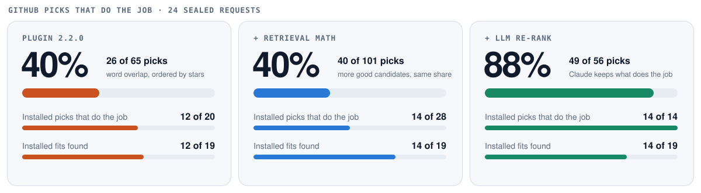
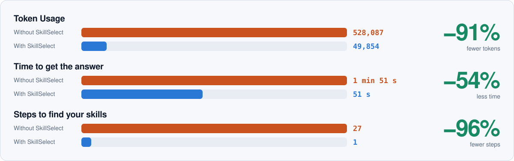
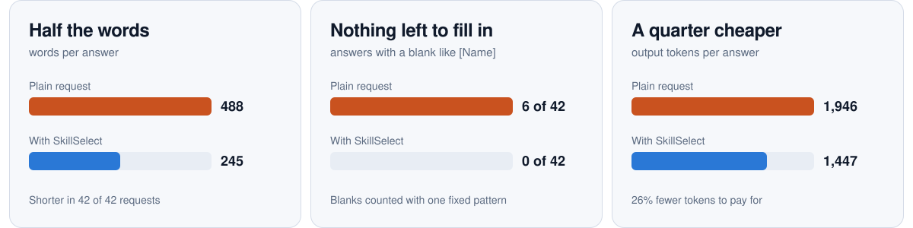

<p align="center">
  <picture>
    <source media="(prefers-color-scheme: dark)" srcset="assets/hero-dark.svg">
    
  </picture>
</p>

**You install many skills and Claude uses one.** SkillSelect is a Claude Code plugin that reads every skill on your computer, scores each one against what you asked for, and tells you which to use, when and how. It also finds skills on GitHub that fit your request. It never installs anything.

<p align="center">
  
</p>

<p align="center"><sub>The film is drawn from saved runs in a test folder with 50 public skills. Asked to build a landing page, plain Claude loaded 1 of the skills that fit in 5 of 6 runs. SkillSelect listed 4 installed skills and 5 from GitHub, each with when and how to use it. <a href="assets/demo.mp4">Download the clip</a>.</sub></p>

<p align="center">
  <a href="LICENSE"></a>
  
  
  
</p>

> **For recruiters**
>
> - **Problem.** People install dozens of agent skills. Asked for a job, the assistant loads one and leaves the rest unused.
> - **What I built.** A two-stage retrieval pipeline in plain Python: query expansion, BM25 with field weights, rank fusion of fit and GitHub stars, then a re-rank step by the model.
> - **How I tested it.** I wrote the pass rule before the run, tuned on 12 requests, froze the code with a checksum, and ran 24 sealed requests once.
> - **Result.** On the sealed requests, GitHub suggestions that do the job went from 40% to 88%, and installed suggestions from 60% to 100%. One real request used 91% fewer tokens than asking without the plugin.

## Start in 3 steps

**1. Install it with one line.** This needs Claude Code 2.1.275 or later.

```
/plugin install skillselect --marketplace alibb007/skillselect
```

On an older version, use two lines:

```
/plugin marketplace add alibb007/skillselect
/plugin install skillselect@skillselect
```

**2. Type what you want to build.**

```
/skillselect build a landing page
```

**3. Read which of your skills fit, and when and how to use each.** You also get up to 5 more from GitHub, each with the command to add it. You run that command yourself.

A second command sorts the skills you already have into categories:

```
/skillselect categorize
```

It needs Python 3. SkillSelect never uploads your skills and never installs or deletes anything. There is no login, no paid API and no telemetry. Only the search words leave your computer, and they go to api.github.com.

To try it without installing, clone the repository and start Claude Code with the folder:

```bash
git clone https://github.com/alibb007/skillselect
claude --plugin-dir skillselect
```

<picture>
  <source media="(prefers-color-scheme: dark)" srcset="assets/flow-dark.svg">
  
</picture>

## What you get

This is the answer from a real run in the test folder, cut to two skills from each list. The full answer is in [evidence/round10](evidence/round10).

> **On your computer** (4 of 50 installed fit)
> - **landing-page-generator**<br>
>   When: you want the page as a Next.js TSX component with Tailwind, with PAS, AIDA or BAB copy, SEO meta and Core Web Vitals targets.<br>
>   How: `/landing-page-generator <what you want>`
> - **epic-design**<br>
>   When: you want a cinematic page built around scroll (parallax, scrollytelling, text reveals, Apple-style animation).<br>
>   How: `/epic-design <what you want>`<br>
>   Needs: pip: Pillow
>
> **On GitHub** (5 you do not have)
> - **landing-page-creator** · Affitor/affiliate-skills · 795 stars · MIT · 2026-10-19<br>
>   When: you want a single self-contained HTML product page. It is written mainly for affiliate pages.<br>
>   Add: `git clone --depth 1 https://github.com/Affitor/affiliate-skills /tmp/affiliate-skills && mkdir -p ~/.claude/skills && cp -R /tmp/affiliate-skills/skills/landing/landing-page-creator ~/.claude/skills/`<br>
>   How: `/landing-page-creator <what you want>`<br>
>   Needs: npx: vercel
> - **design-taste-frontend** · Leonxlnx/taste-skill · 118,520 stars · MIT · 2026-11-08<br>
>   When: you want a polished company site that avoids generic AI-looking design, with plain copy and real product images.<br>
>   Add: `git clone --depth 1 https://github.com/Leonxlnx/taste-skill /tmp/taste-skill && mkdir -p ~/.claude/skills && cp -R /tmp/taste-skill/skills/taste-skill ~/.claude/skills/`<br>
>   How: `/design-taste-frontend <what you want>`
>
> **Start with** `/landing-page-generator`. It's already installed, and it builds a whole landing page with the copy and SEO included.

And `/skillselect categorize` in the same folder, cut to two categories:

> **Your 50 skills by category**
>
> **Web pages (5)**
> - `/landing`: a premium single-file HTML landing page with GSAP and parallax
> - `/landing-page-generator`: a Next.js and Tailwind landing page component
> - `/page-cro`: audits a page that doesn't convert and ranks the fixes
>
> **Documents & office files (4)**
> - `/docx`: creates or edits Word documents
> - `/pptx`: creates or edits slide decks
> - `/xlsx`: creates, cleans or edits spreadsheets and CSVs

With more than 40 skills, each category shows its count and three commands. You can ask for one category in full.

## How it picks

<picture>
  <source media="(prefers-color-scheme: dark)" srcset="assets/pipeline-dark.svg">
  
</picture>

The counts on the arrows are from one run of "landing page" in the 50-skill test folder. 5 of the 50 installed skills passed the gate. On GitHub, 73 repositories led to 106 skill files, and 30 of them passed.

1. **Query expansion.** Claude turns your request into 2 to 4 topic words and up to 6 close words: other names for the same thing, and its file types.
2. **Term model.** Words are cut to their stems. Two words side by side also count as a pair, so "landing page" is a term of its own. Topic words and pairs weigh 1, and close words weigh 0.5.
3. **Candidate gate.** A skill becomes a candidate when it shares two topic words with the request, or one topic word and one close word, or three close words. The gate skips skills. It never skips your request. A skill that shares one common word, such as "page", would only add noise.
4. **Fit score.** Each candidate gets a BM25 score. A rare word counts more than a common one, repeating a word helps less each time, and a word in the skill's name counts 3 times.
5. **GitHub.** The finder sends up to 13 searches to the GitHub API. It opens the repositories that mention your topic and the largest skill collections, and reads the skill files inside them. Those skills pass the same gate and get the same score.
6. **Rank fusion.** Each GitHub skill has a place by fit and a place by stars, and the two places are fused into one number. A famous repository with a weak fit cannot lead, and a perfect fit that nobody has starred cannot lead either. At most 2 skills per repository are listed.
7. **Re-rank.** Claude reads the top 8 installed and the top 12 GitHub descriptions. It keeps at most 5 from each list, and only skills whose own description says they do the job.

```
fit(skill)   = Σ weight(term) × idf(term) × tf × 2.5 / (tf + 1.5 × (0.25 + 0.75 × len / avg))
idf(term)    = ln(1 + (N − df + 0.5) / (df + 0.5))
order(skill) = 1 / (60 + place by fit) + 1 / (60 + place by stars)
```

BM25 with field weights follows Robertson and Zaragoza (2009). Reciprocal rank fusion with k = 60 follows Cormack, Clarke and Büttcher (2009). The design is the usual retrieve, then re-rank. The finder is Python 3 with the standard library only, and the code holds no word list or tuned number.

## Tested

### Does it list skills that do the job?

<picture>
  <source media="(prefers-color-scheme: dark)" srcset="assets/lift-dark.svg">
  
</picture>

Claude Opus wrote 36 everyday requests without seeing any skill name or description. 12 were for tuning and 24 were sealed. I set the pass rule first: at least 10 points more GitHub picks that do the job, with no loss on installed skills. Before the sealed run I froze the code and wrote its sha256 into the rules file. The sealed 24 ran once.

An AI judge, Claude Opus, labelled which skills do each job. It never saw which version had listed a skill.

The new version passed. Job by job it listed more GitHub skills that do the job in 13 of the 24 requests, the same number in 9 and fewer in 2. The rules, the requests, the lists, the labels and the scripts are in [evidence/round9](evidence/round9).

### What one request costs

<picture>
  <source media="(prefers-color-scheme: dark)" srcset="assets/numbers-dark.svg">
  
</picture>

I ran `/skillselect build a landing page for my product` three times in the test folder, each on an empty cache. The runs took 32, 51 and 86 seconds and about 49,900 tokens each, and all three listed the same 9 skills. The picture shows the middle run.

The side without the plugin is one run from 18 Nov 2026. Plain Claude was asked which skills to use and how, with web search and the `gh` command. It took 27 steps, 111 seconds and 528,087 tokens. Both sides are in [evidence/round10](evidence/round10).

I also asked plain Claude to build the landing page in that folder six times, without the plugin. It loaded 1 skill in five runs and 2 in one ([evidence/round7](evidence/round7)).

### Short answers

SkillSelect also adds one sentence to every request, so the answer comes back short and finished. In a test of 42 requests the answers had half the words (245 against 488), and none had a blank left to fill in (0 of 42 against 6 of 42).

<picture>
  <source media="(prefers-color-scheme: dark)" srcset="assets/proof-dark.svg">
  
</picture>

## Limits

- The math alone did not raise the share of GitHub picks that do the job on the sealed requests. It was 40% before and 40% after. It found more good candidates (40 against 26), and the re-rank step turned them into the 88%.
- The judge and the re-rank step are the same model, Claude Opus, so the 88% and the 100% may flatter it. No person labelled the results.
- 5 of the 19 installed skills that fit were still missed.
- Claude Opus wrote the 36 test requests, and I chose the fields they cover.
- The side without the plugin is one run, and the three runs with it all used one request.
- The seconds depend on GitHub. In the three runs the finder call alone took between 9 and 62 seconds.
- The finder runs when you call it by name. Asked in plain words, Claude does not always start it.
- "Needs" lists what a skill's instructions name, found with fixed patterns. It can miss a requirement or list an optional one.
- Nothing is installed for you. Read a skill before you add it, because it is text your assistant will trust.
- Without a GitHub token, GitHub allows 60 API calls an hour, which is enough for a few requests.

## Repo map

| Folder | What it holds |
|---|---|
| [skills/skillselect](skills/skillselect) | The skill's instructions and the finder, `scripts/find_skills.py` |
| [hooks](hooks) | The one sentence that keeps answers short |
| [evidence](evidence) | The rules written before each test, the data and the scripts. Its README lists every round |
| [tools/make_assets.py](tools/make_assets.py) | Draws the pictures on this page from the evidence files |
| [tools/clip](tools/clip) | The film |

To check the sealed scores yourself, put a copy of this repository at commit `e70f08b` in `~/skillselect-2.2.0` and run `score9.py` in `evidence/round9`. It recomputes the table from the saved lists and labels.

```bash
git clone https://github.com/alibb007/skillselect && cd skillselect
git worktree add ~/skillselect-2.2.0 e70f08b
cd evidence/round9 && python3 score9.py sealed
```

## License

[MIT](LICENSE)
