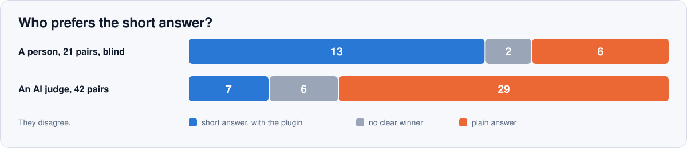
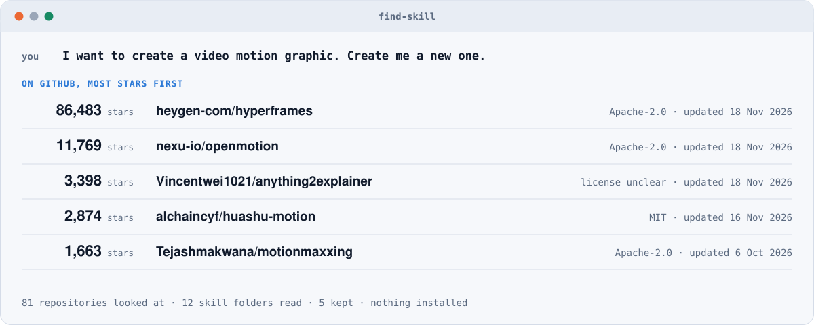

<p align="center">
  <picture>
    <source media="(prefers-color-scheme: dark)" srcset="assets/hero-dark.svg">
    
  </picture>
</p>

<p align="center">
  <a href="LICENSE"></a>
  
  
  
</p>

AI answers are too long, and the right skill is hard to find. **Straight Answer** is one Claude Code plugin that fixes both. Install it once and keep asking the way you already do.

## What it does

<picture>
  <source media="(prefers-color-scheme: dark)" srcset="assets/flow-dark.svg">
  
</picture>

**Short, finished answers.** It adds one sentence to every request for you:

> Use my exact facts and numbers, and give me a short, finished answer I can use as it is, with no placeholders, no generic templates and nothing I did not ask for.

**Finds a skill for the job.** Say what you want to make. It checks the skills you already have, then lists the ones on GitHub with the most stars first, each with its license and last update. It installs nothing.

## Install

In Claude Code:

```
/plugin marketplace add alibb007/straight-answer
/plugin install straight-answer@straight-answer
```

To try it without installing, clone the repository and start Claude Code with the folder:

```bash
git clone https://github.com/alibb007/straight-answer
claude --plugin-dir straight-answer
```

It needs Python 3. There is no account, no API key and no telemetry.

## Proof

I ran 42 everyday requests, and Claude Opus answered each one twice: once as written and once with the plugin's sentence added.

<picture>
  <source media="(prefers-color-scheme: dark)" srcset="assets/proof-dark.svg">
  
</picture>

I judged 21 of the pairs blind and picked the short answer 13 times and the plain one 6 times. An AI judge read all 42 pairs and preferred the longer answer 29 times to 7. In its notes it praises the extra advice. So this plugin is for people who want the short answer.

<picture>
  <source media="(prefers-color-scheme: dark)" srcset="assets/vote-dark.svg">
  
</picture>

## The finder

This is a real run from 18 Nov 2026. Ask in your own words, or call it by name with `/straight-answer:find-skill`.

<picture>
  <source media="(prefers-color-scheme: dark)" srcset="assets/finder-dark.svg">
  
</picture>

It looks at your own skills first and matches them by what each skill says about itself. Then it searches GitHub: it opens the repositories that mention your topic and the largest skill collections, reads the skill folders inside them, keeps the ones that fit at least half of your key words, and sorts them by stars. Each result shows the license and the last update, with a warning when a repository is archived, has no license, or has had no update for a year.

Only the search words leave your machine, and they go to api.github.com. Nothing about your own skills is sent.

### What other finders miss

| Tool | Looks at what you already have | Names the skill inside a big repository | Leaves the installing to you |
|---|---|---|---|
| `npx skills find` | No | Searches its own hosted list, ranked by installs | Installs on select |
| skills-janitor discover | By folder name only | No, finds whole repositories | Yes |
| deep-skill-finder | No | Hosted market | Installs for you |
| **Straight Answer** | **Yes, by what the skill says** | **Yes** | **Yes** |

From their own docs and code, read on 18 Nov 2026. I did not run them.

## Evidence

Everything behind the numbers is in the [evidence](evidence) folder: the rules written before each test, all requests, every answer, every verdict, and the scripts. Round 3 tested the sentence the plugin uses. Round 2 tested an earlier sentence without the word "short": the AI judge preferred it over a plain request 39 times to 8, and it cost 50% more output tokens.

## Limits

- Tested on one model, Claude Opus, with requests written by the same model.
- One person voted, on 21 pairs.
- The finder matches words, so a search for a legal contract review also returned smart-contract skills. Read a skill before you add it.
- Without a GitHub token the finder can run about two searches an hour.

## License

[MIT](LICENSE)
